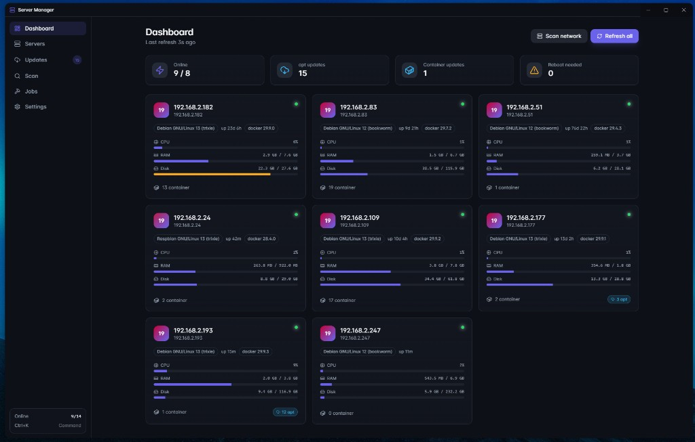

# Server Manager

Modern Windows desktop app to manage a fleet of home-lab Linux servers over SSH. Scans your network, lists Docker stacks and apt updates per host, and runs upgrades with live log streaming.



See [SERVER-MANAGER.md](SERVER-MANAGER.md) for the full project doc and database schema.

## Features
- **Network scan** of your subnet, probes port 22 and common web ports
- **Dashboard** with all servers at a glance: OS, uptime, CPU / RAM / Disk bars, container count, update badges
- **Server detail** with Overview, Docker (stacks + status indicators), Packages, Terminal, History tabs
- **Docker updates** per stack via `docker compose pull && up -d` with the project's `working_dir` resolved from container labels
- **apt updates** with regular `upgrade` and `full-upgrade` (dist-upgrade) choices, plus autoremove + autoclean at the end of every job
- **Reboot prompt** after upgrades that leave `/var/run/reboot-required`
- **Image update detection** by comparing local `RepoDigest` with registry `Docker-Content-Digest` (Docker Hub, GHCR, LSCR, Quay) with caching
- **Integrated xterm.js SSH terminal** per server
- **Live job logs** streamed to the UI
- **Command palette** (Ctrl+K)
- Credentials encrypted at rest via Electron `safeStorage` (Windows DPAPI)

## Download

A pre-built Windows installer is in [release/](release/) (NSIS, ~88 MB). Just run `Server Manager-Setup-*.exe`.

## Build from source

```powershell
npm install
npm run dev           # dev server with HMR + main-process --watch
npm run build:win     # produces release\Server Manager-Setup-<version>.exe
```

## First run
1. Open **Settings** -> add a credential (e.g. `root` / `root`, mark as default).
2. Open **Scan**, confirm your subnet, click **Start scan**.
3. Click **Add** on each discovered server (or go to **Servers** -> **Add server** to enter one manually).
4. Hit **Refresh all** on the dashboard.

## Notes on appliance systems
- **RaspberryMatic** holds its base system via apt pins. Don't `apt upgrade`/`full-upgrade` - update via the HomeMatic WebUI.
- **Proxmox**, **OMV**, **TrueNAS**, **DSM**, **Unraid** have their own update mechanisms - prefer those over apt where possible.

## Development
- `src/main/` - Electron main: SSH pool, scanner, collector, job runner, DB
- `src/preload/` - typed IPC bridge
- `src/renderer/` - React UI
- `src/shared/` - types shared between main and renderer

The renderer is served over a custom `app://` protocol in production so a strict CSP (`script-src 'self'`) still works - loading via plain `file://` would silently block module scripts.
